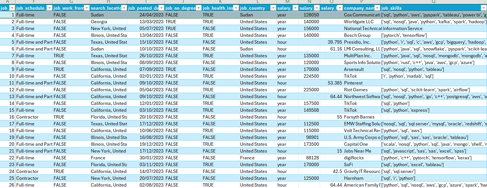
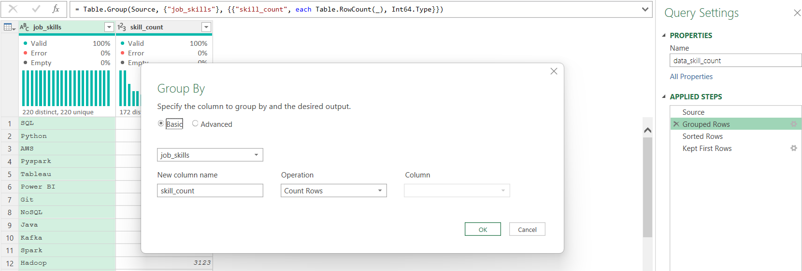
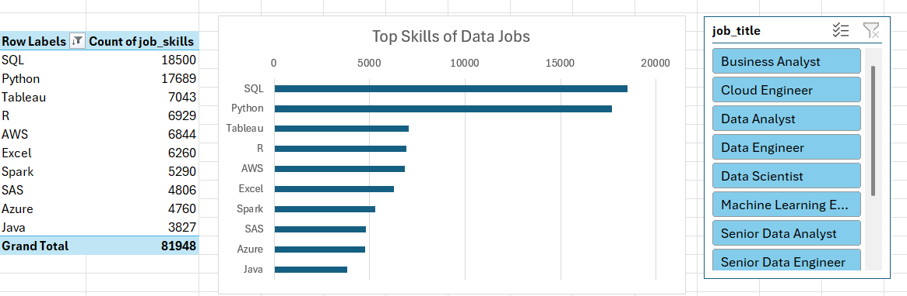

# Excel-Job-Market-Analysis

## Project Overview

This project explores data-related job postings using Microsoft Excel and Power Query. The aim was to clean and transform the dataset, analyse the skills required by employers, and identify the most frequently mentioned skills.

The project demonstrates a practical data preparation and analysis workflow, from the original dataset to a summary of the most in-demand skills.

## Dataset

The project uses a dataset of **32,672 data-related job postings** provided in the course resources for [Luke Barousse's Excel for Data Analytics course](https://www.youtube.com/@LukeBarousse).

The dataset includes information such as:
- Job titles and locations
- Employment types and remote-work options
- Posting dates
- Salary information
- Company names
- Required skills

## Tools Used

- **Microsoft Excel** – data analysis, PivotTables and charts
- **Power Query** – data cleaning, transformation and aggregation

## Data Preparation and Transformation

I used Power Query to prepare the data and create three queries:

### 1. `data_jobs` – Main dataset

- Set appropriate data types for the columns.
- Cleaned the `job_via` column.
- Added a sequential `job_id` to identify individual job postings.

The resulting table contains 32,672 job postings and 17 columns.

### 2. `data_skills` – Expanded skills dataset

- Created a reference to the main dataset.
- Cleaned the skills column by removing unnecessary characters and spaces.
- Split the skills into individual values.
- Expanded the resulting values into separate rows, keeping each skill linked to its original job posting.

This produced a dataset of 167,270 rows, with one skill per row.

### 3. `data_skill_count` – Skills aggregation

- Created a reference to the expanded skills dataset.
- Grouped the data by skill.
- Counted how many times each skill appeared.
- Sorted the results in descending order and selected the top 10 skills.

## Skills Analysis

I also created a PivotTable and a horizontal bar chart in Excel using the expanded skills dataset.

The PivotTable summarises the frequency of each skill. Its results were compared with the Power Query aggregation to check that both approaches produced matching counts.

### Top 10 Most Frequently Mentioned Skills

## Key Findings

- SQL and Python were the two most frequently mentioned skills in the dataset.
- Tableau and R also appeared frequently in job requirements.
- Cloud platforms such as AWS and Azure featured among the top 10 skills.
- Excel remained a commonly requested skill in data-related job postings.

## What I Learned

Through this project, I practised:

- Cleaning and transforming data using Power Query.
- Creating reference queries and working with multiple related datasets.
- Splitting and expanding data into individual records.
- Grouping data and calculating counts.
- Creating PivotTables and charts to summarise results.
- Checking results by comparing two different approaches to aggregation.

## Project Files

- `Excel_Job_Market_Analysis.xlsx` – Excel workbook containing the prepared datasets, Power Query results, PivotTable and chart.
- `screenshots/` – screenshots showing selected data preparation and analysis steps.
